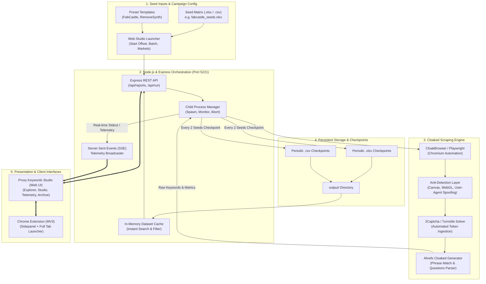
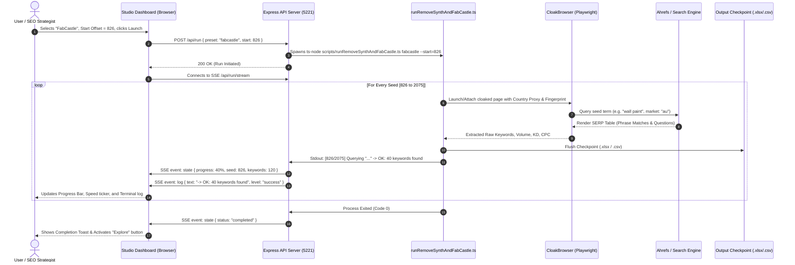

# Proxy Keywords Studio — System Architecture & Workflow

> **Autonomous Keyword Discovery, Live Telemetry & Dataset Intelligence Engine**

---

## 1. Executive Overview

**Proxy Keywords** is an enterprise-grade keyword research intelligence platform. It automates the discovery, extraction, cross-market normalization, and analysis of search demand data across global markets.

Unlike traditional keyword tools that rely on expensive, rate-limited APIs or manual copy-pasting, Proxy Keywords uses an **undetected cloaked headless browser engine** coupled with a **real-time streaming full-stack dashboard** and a **Chrome Extension (Manifest V3)** sidepanel.

---

## 2. High-Level Architecture Flowchart



---

## 3. End-to-End Execution Sequence Diagram



---

## 4. Comprehensive Technology Stack

| Layer | Technologies Used | Key Purpose & Advantage |
|---|---|---|
| **Frontend UI** | **Vanilla HTML5, CSS3, JavaScript (ES2022)** | Zero bundle overhead, instant load speed (<20ms), maximum styling flexibility without CSS framework lock-in. |
| **Design System** | **Dark Glassmorphism, Google Fonts (`Outfit`, `Inter`, `JetBrains Mono`)** | Curated dark aesthetic (`#07090E`), ambient glows, translucent blurs (`backdrop-filter`), micro-animations, and responsive tables. |
| **Backend Server** | **Node.js, Express 5, TypeScript (`ts-node`)** | High-performance asynchronous REST API handling dataset parsing, live child process orchestration, and file streaming. |
| **Real-Time Streaming** | **Server-Sent Events (SSE)** | Unidirectional, lightweight persistent HTTP stream for telemetry, log lines, and progress without WebSocket handshake overhead. |
| **Scraping Engine** | **CloakBrowser & Playwright-Core** | Undetected browser automation engine with native stealth patches preventing Cloudflare/DataDome detection. |
| **CAPTCHA Defense** | **`@2captcha/captcha-solver`** | Automated background token solving for turnstiles and challenge walls. |
| **Spreadsheet Engine** | **SheetJS (`xlsx`) & CSV Engine** | Bidirectional matrix parsing from `.xlsx`, `.csv`, `.tsv`, producing formatted multi-sheet workbooks. |
| **Extension Bridge** | **Chrome Extension Manifest V3 (CRXJS + Vite)** | Native Chrome sidepanel UI with instant one-click launcher to open the Web Studio in a full tab. |

---

## 5. Core Pipeline Breakdown

### 5.1 Matrix Multiplication of Seeds & Markets
Seed keywords are grouped into tools (e.g. *STL volume calculator*, *Wall paint estimator*, *Home loan calculator*) and categories.
The matrix multiplier evaluates each seed across target markets:
- 🇮🇳 **India (`in`)**
- 🇺🇸 **United States (`us`)**
- 🇬🇧 **United Kingdom (`gb`)**
- 🇦🇺 **Australia (`au`)**
- 🇦🇪 **United Arab Emirates (`ae`)**
- 🇨🇦 **Canada (`ca`)** / 🇩🇪 **Germany (`de`)**

Total search matrix: `N Seeds × M Markets = Total Queries`. For FabCastle, this is **2,075 seed queries**.

### 5.2 Cloaked Extraction & Anti-Fingerprinting
A regular headless Chromium browser is immediately flagged by search intelligence providers. Proxy Keywords utilizes `cloakbrowser`:
- Generates randomized browser fingerprints (screen resolution, GPU vendor, audio context).
- Sets realistic viewport metrics and mouse curves.
- Bypasses automated bot flags (`navigator.webdriver = false`).

### 5.3 Two-Way Checkpointing & Resumption
Scraping 2,000+ seeds over the network can take hours. To guarantee zero data loss:
- **Periodic Disk Checkpoint**: After every 2 seed lookups, the script rewrites `output/<project>_keywords_<timestamp>.xlsx` and `.csv`.
- **Start Offset Resume (`--start=N`)**: If a run is interrupted or halted at seed #825, the user simply enters `826` in the Studio launcher or CLI to immediately resume from seed 826 without reprocessing seeds 1 through 825.

### 5.4 In-Memory Caching & Instant Exploration
Parsing a 25,000-row Excel file on every table filter would cause UI lag.
- The Express backend parses the file once on first access and stores the structured rows in `reportCache`.
- Subsequent searches, filters (KD, Volume, Country), and sorts execute in **under 5 milliseconds**.

---

## 6. Web Studio Feature Walkthrough

### 1. Keyword Explorer
- **Instant Search**: Real-time debounced filtering across keyword, seed, and tool origin.
- **KD Tier Segmented Selector**: Filter between Easy (`<15`), Medium (`15-29`), Hard (`30+`), or All.
- **Quick Preset Chips**:
  - `🔥 High Volume (≥1K)`: Surfaced immediately.
  - `💎 Low KD Gems (<15)`: Low-hanging fruit keywords.
  - `❓ Questions`: Informational intent keywords for FAQ schema and blog posts.
- **Slide-Over Detail Drawer**: Click any row in the table to view:
  - Estimated CPC and Search Volume.
  - Parent seed origin and tool attribution.
  - AI Opportunity Assessment (Ranking viability).
  - Direct Google SERP live verification link.
- **Export**: One-click download of filtered or full `.xlsx` and `.csv` files.

### 2. Research Studio (Launcher)
- Interactive preset matrix selection (`FabCastle`, `RemoveSynth`).
- Start Offset input for instant recovery.
- Maximum seeds cap for quick testing.
- Target country checkboxes.

### 3. Live Telemetry
- **Progress Gauge**: Real-time percentage, current/total seed counter.
- **Speed & Timer HUD**: Live seeds/minute processing rate and elapsed session timer.
- **KPI Counters**: Discovered keywords, Phrase Matches, Questions, Handoffs, Errors.
- **Terminal Console**: Live streamed console output with autoscroll toggle, copy, and clear.
- **Abort Run**: Safe stop button that flushes checkpoints and gracefully closes the browser.

### 4. Report Archive
- Historical list of all generated files in `output/`.
- File size, format badge (`XLSX` vs `CSV`), and modification date.
- Instant "Explore" button to load into the Keyword Explorer.

---

## 7. How to Operate

### Start the Full-Stack Web Studio
```bash
npm run studio
```
Open **`http://localhost:5221`** in any web browser.

### Start the Chrome Extension
```bash
npm run dev
```
Load the unpacked extension from `dist-dev/` in Chrome (`chrome://extensions`). Click **"Open Studio ↗"** to open the full dashboard.

### Run via Command-Line
```bash
# Run FabCastle from seed #826
npx ts-node scripts/runRemoveSynthAndFabCastle.ts fabcastle --start=826

# Run RemoveSynth
npx ts-node scripts/runRemoveSynthAndFabCastle.ts removesynth
```
