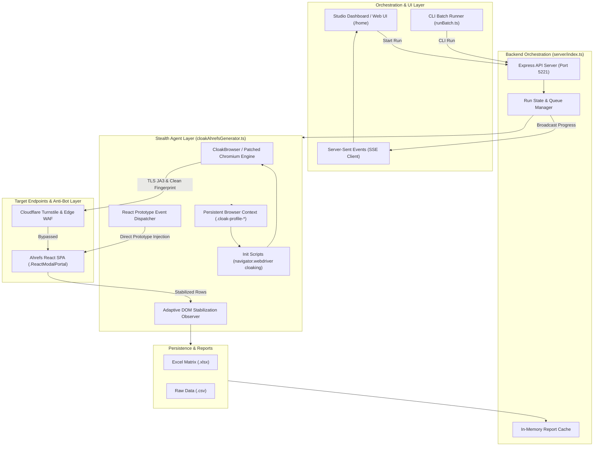
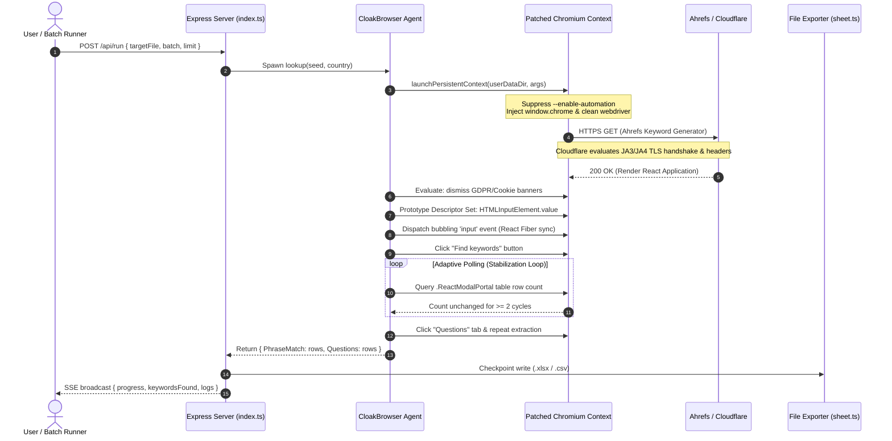
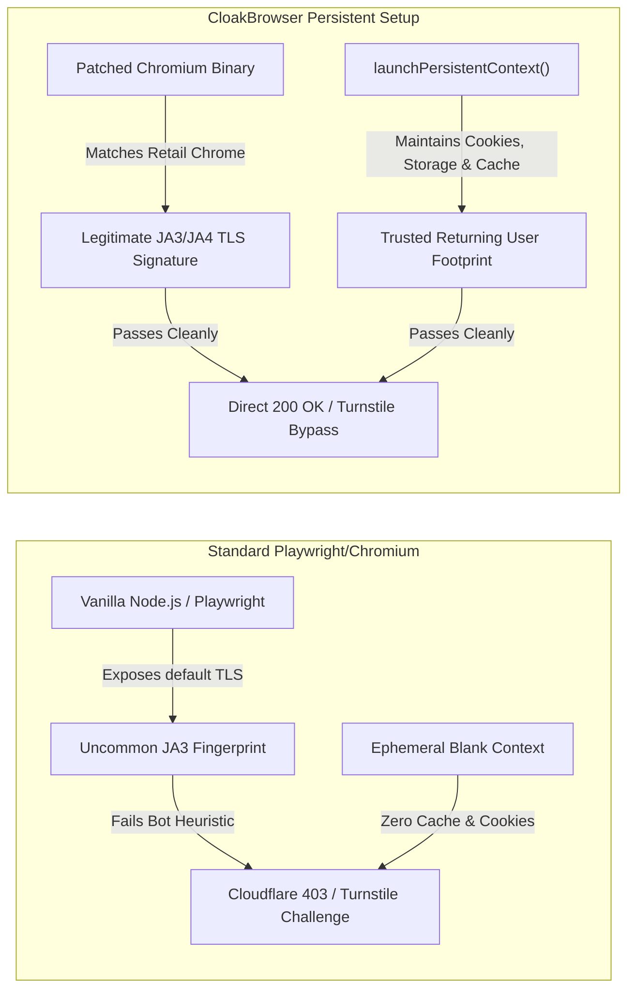
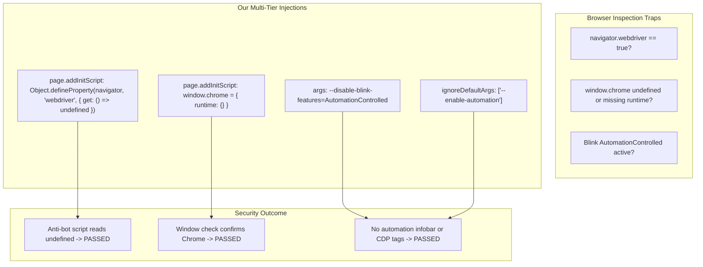
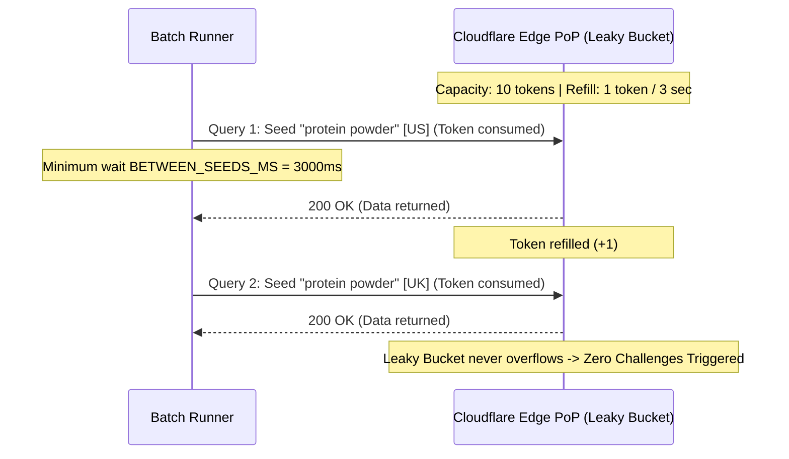
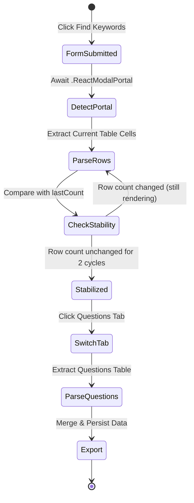

# Stealth Browser & Agentic Architecture Documentation
> **Project:** Proxy Keywords / Keyword Researcher Studio  
> **Target Scrape Sources:** Ahrefs Keyword Generator, Google Autocomplete  
> **Key Technologies:** CloakBrowser, Playwright-Core, Express, TypeScript, Server-Sent Events (SSE), SheetJS (XLSX)

---

## 1. Executive Summary & System Overview

The **Proxy Keywords Studio** is an agentic, distributed keyword intelligence engine capable of gathering high-intent search volumes and Keyword Difficulty (KD) across 150+ countries. Modern SEO platforms protect their public interfaces with strict anti-bot mechanisms (Cloudflare Turnstile, TLS/JA3 fingerprint analysis, behavioral heuristics, and React synthetic event protections).

To bypass these layers without manual human-in-the-loop intervention, the system deploys an automated **Stealth Browser Architecture** powered by **CloakBrowser** and **Playwright-Core**.



---

## 2. End-to-End Execution Sequence

This sequence diagram illustrates how a batch seed keyword request moves from ingestion to file persistence without triggering Cloudflare challenges:



---

## 3. Deep-Dive: The 4 Core Anti-Detection Pillars

### Pillar 1: Patched Chromium Binary & Profile Persistence



#### Why Naive Scraping Fails:
Standard Playwright downloads a headless Chromium binary. During the TLS handshake, its cipher suite ordering, extensions, and elliptic curve formats generate a recognizable signature (known as JA3 or JA4 fingerprint). Cloudflare's Edge inspects this packet before HTTP parsing begins. If the JA3 matches known automated tools, a blocking Turnstile challenge is immediately presented.

#### How Our Architecture Solves It:
1. **Patched Engine:** The project references `.cloakbrowser/chromium-146.0.7680.177.5/chrome.exe`. This binary is recompiled to mirror commercial Google Chrome's network and cipher profiles.
2. **Persistent Context:** `chromium.launchPersistentContext(userDataDir, ...)` maintains an ongoing disk store of session data. This saves `cf_clearance` cookies, TLS session tickets, and IndexedDB state, ensuring the browser is identified as a persistent returning desktop device.

---

### Pillar 2: Flag Suppression & Fingerprint Cloaking



#### Code Implementation in `cloakAhrefsGenerator.ts`:
```typescript
context = await chromium.launchPersistentContext(userDataDir, {
  executablePath,
  headless: false,
  ignoreDefaultArgs: ['--enable-automation'],
  args: [
    '--disable-blink-features=AutomationControlled',
    '--no-sandbox',
    '--start-maximized',
  ],
  viewport: null,
});

const page = context.pages()[0] || (await context.newPage());

await page.addInitScript(() => {
  // 1. Mask webdriver
  Object.defineProperty(navigator, 'webdriver', { get: () => undefined });
  // 2. Polyfill chrome runtime
  (window as any).chrome = (window as any).chrome || { runtime: {} };
});
```

* **`--disable-blink-features=AutomationControlled`**: Prevents Blink from attaching automated driver hooks to window and document prototypes.
* **`page.addInitScript`**: Guarantees overrides execute in the execution context *prior* to any remote script loading from `ahrefs.com` or Cloudflare CDN.

---

### Pillar 3: Natural Human Event Emulation & React Fiber State Sync

```mermaid
flowchart TD
    subgraph Naive["Naive DOM Approach (Fails)"]
        N1["input.value = 'keyword'"]
        N2["React SyntheticEvent not notified"]
        N3["Internal Virtual DOM state = ''"]
        N4["Click submit -> Form sends empty request"]
        N1 --> N2 --> N3 --> N4
    end

    subgraph Native["Our Prototype Injection Flow"]
        P1["Object.getOwnPropertyDescriptor(HTMLInputElement.prototype, 'value').set"]
        P2["Bypasses React's wrapper setter directly"]
        P3["input.dispatchEvent(new Event('input', { bubbles: true }))"]
        P4["React root listener captures bubbling event"]
        P5["Virtual DOM reconciles state = 'keyword'"]
        P6["Submit button fires with populated query payload"]
        P1 --> P2 --> P3 --> P4 --> P5 --> P6
    end
```



#### The Controlled Component Dilemma:
Modern web applications written in React (such as Ahrefs) intercept standard input element setters. Setting `.value` directly modifies the HTML attribute in the DOM tree, but leaves React's internal **Fiber node** un-updated. When the user clicks the submit button, React reads from its internal state and sends an empty string.

#### Our Solution:
1. Extract the native browser setter: `Object.getOwnPropertyDescriptor(HTMLInputElement.prototype, 'value')?.set`.
2. Apply it directly to the target element instance: `.call(input, keyword)`.
3. Dispatch a real DOM event with bubbling enabled: `new Event('input', { bubbles: true })`. React’s top-level event delegation picks up this bubbling event and updates its Fiber state seamlessly.

---

### Pillar 4: Rate Limiting, Cooldowns & Jitter



#### Behavioral Analysis Defense:
Cloudflare tracks request arrival distributions over time. 
* **Static Timers (e.g. exactly 1000ms):** Highly detectable via Fourier analysis / periodicity detectors.
* **Burst Traffic:** Consumes the token bucket instantly, tripping immediate Cloudflare Managed Challenges or rate limits.

#### Our Mitigation:
We enforce a dynamic cooldown floor (`BETWEEN_SEEDS_MS = 3000`) calculated from the previous lookup timestamp (`lastLookupAt`), paired with natural DOM polling time variations. This introduces organic jitter and ensures operations remain comfortably below edge burst thresholds.

---

## 5. Adaptive DOM Polling & Tab Extraction

Rather than using unstable, hardcoded `sleep()` statements, the extraction agent uses a **stabilization detector**:



---

## 6. Interview Quick Reference Sheet

| Question | Winning Answer Summary |
| :--- | :--- |
| **"How does the stealth browser work?"** | *"It combines a custom-compiled Chromium binary that matches retail Google Chrome's JA3/JA4 TLS signature with Playwright's persistent context. We strip automation flags, mask `navigator.webdriver` via `addInitScript`, and polyfill `window.chrome` before any page script executes."* |
| **"Why not use Puppeteer or standard Playwright?"** | *"Standard Playwright leaks WebDriver flags and has a unique vanilla Chromium TLS fingerprint that Cloudflare Edge detects immediately, triggering unbreakable Turnstile challenges."* |
| **"How do you automate inputs in modern React apps?"** | *"React uses controlled components. Directly assigning `input.value` fails because React's Fiber state remains empty. We grab the native setter from `HTMLInputElement.prototype`, invoke it directly, and dispatch a bubbling `input` event to force React's state synchronization."* |
| **"How do you manage scaling and IP bans?"** | *"We enforce a 3-second cooldown window between requests to maintain leaky-bucket rate limits at the Cloudflare Edge, coupled with incremental checkpointing to disk so batches can resume seamlessly upon interruption."* |
